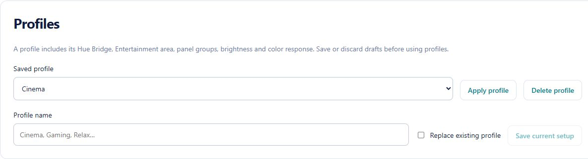
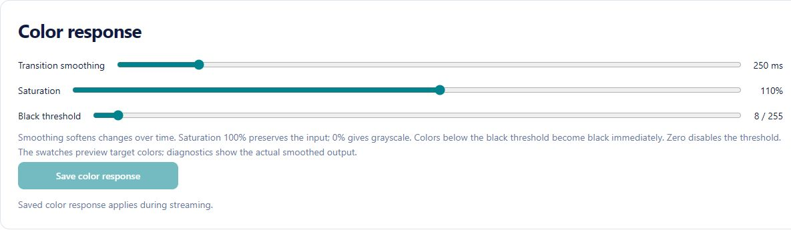

# Nanoleaf Hue Bridge

Use a **Nanoleaf 4D camera to synchronize Philips Hue lights** through a virtual
Shapes receiver. Version **4.0.0** receives Sync+ UDP colors directly from the
4D, with nine virtual panels, guided Debian 12 installation and an English web portal.
Physical Shapes are no longer required by the receiver, and no ARP relay is started.

**Pair and configure the virtual device only in Nanoleaf Desktop on the same LAN.**
iPhone/iPad and HomeKit pairing are currently unsupported. Version 4 does not
advertise a HomeKit accessory or provide a QR code/PIN. Do not use the iPhone
Sync+ placement editor for this virtual device: in the tested setup, saving there
removed it from the 4D's actual receiver configuration.

This is an **experimental prerelease**. Direct reception and Hue output work on
the development installation, including operation after removing HomeKit.
The complete fresh-system Desktop-only onboarding still needs an independent
hardware installation test. Nanoleaf app/firmware compatibility is not guaranteed.

## How it works

```text
4D camera -> Sync+ UDP colors -> virtual Shapes (nine panels)
                                   -> Hue Entertainment -> Hue lights
Desktop / web portal On/Off --------> enable / release Hue stream
```

The virtual device implements the tested Desktop API handshake and extControl v2
UDP reception on port 60222. Hue uses HueStream v2 over DTLS rather than per-frame
REST commands. API pairing and adding the virtual device to the 4D Sync+ setup are
two separate steps; both are required. This project does not access the camera's video.

## Before installing

**Proxmox is not required.** Debian 12 can run on a physical machine, a VM,
or an LXC/system container on any suitable platform. It must run systemd and
allow LAN discovery and incoming TCP/UDP traffic. A minimal Docker-style
application container without systemd is not supported by this installer.
Hardware testing so far used Debian 12 in LXC; other hosts have not yet been
independently validated.

- A fresh Debian 12 system running systemd: 1 CPU, 512 MB RAM, at least 4 GB disk,
  Internet access and a stable IPv4 address.
- A Nanoleaf 4D and its IPv4 address; Screen Mirror must be available.
- Nanoleaf Desktop on a computer on the **same LAN** as the Debian system and 4D.
- A Hue Bridge supporting Entertainment, its IPv4 address, and an Entertainment
  area created in the Hue app with the lights you want to use.
- Access to the Hue Bridge's physical link button for initial authorization.

The installer detects the Debian system address/interface and generates the virtual
identity. Physical device MAC addresses, physical Shapes and HomeKit codes are not
needed. Configure VLANs, DHCP reservations and Wi-Fi client isolation beforehand;
the installer does not configure your virtualization platform, routers or access points. Allow mDNS
discovery (UDP 5353), the virtual API (TCP 16021), Sync+ (UDP 60222), and the
portal (TCP 8080) on your trusted LAN. Run one bridge instance for this configuration.

## Install on a fresh Debian 12 system

Run this block as root on the Debian 12 system:

```bash
apt-get update && apt-get install -y ca-certificates curl
curl -fL https://raw.githubusercontent.com/Cristef/nanoleaf-hue-bridge/v4.0.0/bootstrap.sh -o /root/nanoleaf-hue-bootstrap.sh
bash /root/nanoleaf-hue-bootstrap.sh
```

The bootstrap downloads this release. The installer upgrades Debian packages,
installs libraries and a Python environment, creates services, and guides you
through addresses, virtual name, Desktop pairing, Hue authorization and area selection.
Alternatively, extract the [release ZIP](https://github.com/Cristef/nanoleaf-hue-bridge/releases/tag/v4.0.0)
and run `bash install.sh` from its directory.

During Nanoleaf pairing, choose the **power-button method in Desktop** within
the two-minute window opened by the wizard. The virtual button is already pressed.
Then add the receiver to the 4D Sync+ configuration in Desktop, set its position,
save and start Screen Mirror. If necessary, finish pairing later in the portal.
Press the physical Hue Bridge button when prompted and select your Entertainment area.

Ensure the Debian system starts automatically if you want continuous operation.
For a VM or container, enable autostart in your hosting platform (for example,
**Start at boot** in Proxmox). The installer enables the bridge services at boot.
Open `http://DEBIAN_IP:8080/`
and create your username and password (minimum eight characters). No access key
is required on first use. See the [complete installation and pairing guide](docs/INSTALLATION_V4.md).

## Use the web portal

- **Lights:** watch live panel colors and assign a panel or panel group to each
  Hue channel. Groups use the mean color; multiple lights can share a group.
  Adjust global and individual brightness, and identify a lamp while streaming.
- **Profiles:** save and switch mapping, area, brightness and color-response settings.
- **Color response:** adjust smoothing, saturation and black threshold.
- **Settings & pairing:** reopen the two-minute Desktop pairing window, authorize
  a Hue Bridge, refresh lights and choose another Entertainment area.
- **Diagnostics:** check API pairing, recent frames, Hue stream phase and sent colors.
- **Backup:** export and review/import settings without credentials. Use a full system backup or a VM/container
  snapshot for recovery; a settings export is not a pairing backup.

The mapping supports all channels in the selected Hue area, including a synthetic
ten-channel test. Hardware validation used two Hue lights; larger areas have not
yet been tested with real lights. Positioning in Desktop determines the colors
sent to the nine virtual panels. Map lights to those panels in the portal.

Version 4 screenshots below use synthetic lights and addresses. Virtual panel IDs
are 1 through 9. The profile and color-response screenshots illustrate the
unchanged controls from version 3.





## Daily operation

Keep the Debian system and services running. Turn the virtual device on/off in
Desktop or the portal. On waits for incoming colors before claiming the Hue area;
Off releases it without switching off the bulbs. Two seconds without fresh frames
releases the stream; new frames resume it while the virtual device is on.
The maintenance menu is `nanoleaf-hue`. Pairings and settings survive service restarts.
Avoid other applications streaming to the same Hue Entertainment area.

## Upgrade from version 3

Take a full system backup or VM/container snapshot first. Download/extract version 4 and run:

```bash
bash update.sh
```

The updater supports `/opt/nanoleaf-hue` installations created by the public
installer. It makes a private backup in `/root/nanoleaf-hue-backups`, preserves
accounts, identities, API tokens, Hue credentials and profiles, disables HomeKit,
and replaces ARP capture with direct reception. Startup failure triggers rollback.
Private prototype installations at `/opt/nanoleaf-probe` are not supported by it.

Use Desktop to pair if necessary and register the virtual recipient in 4D Sync+.
Review existing mappings: physical panel IDs from version 3 do not match the new
virtual IDs 1-9. Reassign groups before using saved old profiles. Changing area
also clears active channel groups and individual brightness for that area.

## Troubleshooting and security

For missing colors, verify Desktop pairing **and** 4D Sync+ recipient selection,
Screen Mirror, source IP, UDP reachability and Wi-Fi isolation. A disconnected
iPhone entry does not indicate Desktop/API failure; iPhone pairing is unsupported.
For Hue problems, verify link-button authorization, area membership and competing
streams. Consult portal diagnostics or `nanoleaf-hue` -> Diagnostics.

The portal uses password hashing, authenticated sessions and origin/CSRF checks.
It is HTTP on a trusted LAN: do not expose it to the Internet. First-login setup
is available until the initial account is created; finish it promptly. Internal
API tokens and Hue credentials stay on the Debian system and are excluded from exports.

## Development and license

On Linux with Python 3.11/3.12, install `requirements.txt` and run
`python tests/run.py` and `bash -n install.sh bootstrap.sh update.sh`.
The tests use synthetic addresses and isolated state. Archived relay/HomeKit
modules remain for compatibility/regression coverage; public version 4 services
do not enable them. This is not an official Nanoleaf or Philips Hue product.

This project is **source-available for noncommercial use** under
[PolyForm Noncommercial 1.0.0](LICENSE). Commercial-use rights are not granted.
Third-party libraries retain their own licenses: see [NOTICE.md](NOTICE.md) and
[LICENSE_AUDIT.md](LICENSE_AUDIT.md).
