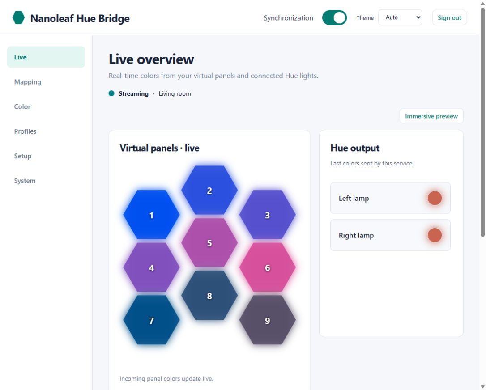
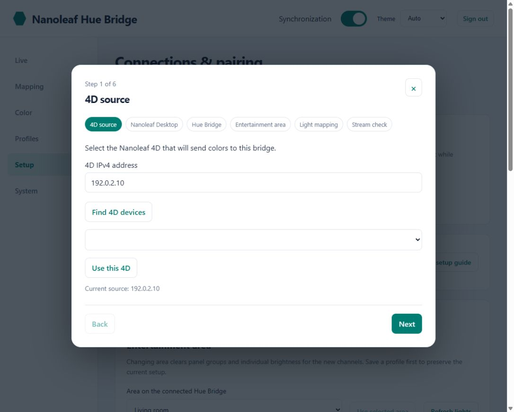
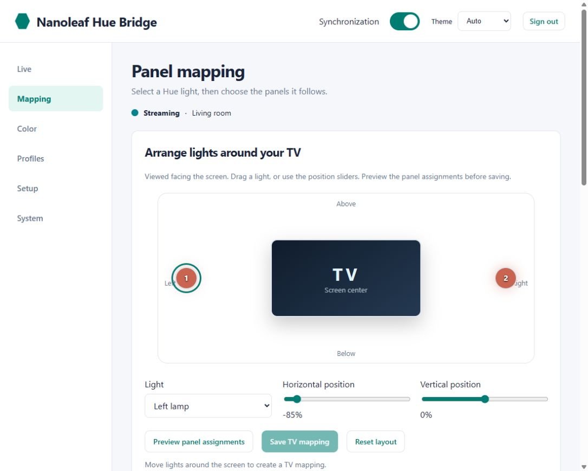
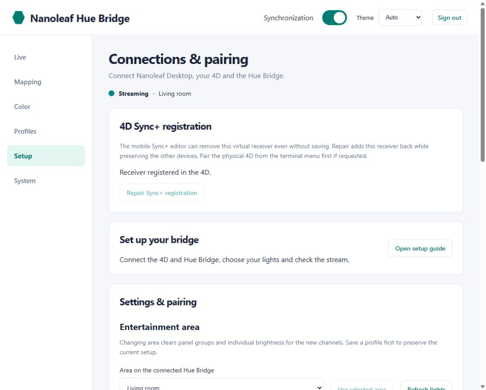

# Nanoleaf Hue Bridge

Bring your Philips Hue lights into a Nanoleaf 4D setup. The bridge appears as a virtual Shapes device, receives colors from the 4D over Sync+, and sends them to a Hue Entertainment area.

It runs on Debian 12 and provides a web portal for mapping colors to lights, adjusting the output and saving profiles. You can also control it from [Home Assistant](https://github.com/Cristef/nanoleaf-hue-bridge-ha).

**Setup requires Nanoleaf Desktop on the same LAN.** iPhone, iPad and HomeKit pairing are not supported.

## What you need

- A Nanoleaf 4D and a computer running Nanoleaf Desktop.
- A Hue Bridge with an Entertainment area containing the lights you want to use.
- A Debian 12 system with systemd, Internet access and a stable IPv4 address. Allow at least 1 CPU, 512 MB RAM and 4 GB of disk space.
- The IPv4 addresses of the 4D and Hue Bridge, and access to the power button on the 4D and the link button on the Hue Bridge.

Debian can run on a physical machine, a VM or an LXC container. Proxmox is optional. The installer expects systemd, so a minimal Docker container is not suitable.

Keep the Debian system, 4D and Nanoleaf Desktop on the same LAN for discovery and pairing. If you use VLANs or Wi-Fi client isolation, configure network access before installing. The installer handles the application, not the network.

## Install

Run these commands as root on a fresh Debian 12 system:

```bash
apt-get update && apt-get install -y ca-certificates curl
curl -fL https://raw.githubusercontent.com/Cristef/nanoleaf-hue-bridge/v4.4.0/bootstrap.sh -o /root/nanoleaf-hue-bootstrap.sh
bash /root/nanoleaf-hue-bootstrap.sh
```

The installer updates Debian, installs the dependencies and sets up the services. It then asks for the device addresses and guides you through pairing and Hue area selection.

You can also download the [release ZIP](https://github.com/Cristef/nanoleaf-hue-bridge/releases/tag/v4.4.0), extract it and run `bash install.sh`.

When the wizard opens the Nanoleaf pairing window, choose **power-button pairing** in Nanoleaf Desktop. There is no physical button to press: the wizard opens that window for two minutes. The installer then registers the virtual receiver directly in the 4D through its API. Hold the physical 4D power button for five seconds when prompted. Existing receivers and screen dimensions are preserved; a new virtual receiver starts at the center of the configured space. Start Screen Mirror on the 4D after setup.

For Hue, press the Bridge's link button when prompted and choose your Entertainment area. The services are enabled at boot; enable autostart for the host or VM/container as well if you want the bridge available all the time.

Open `http://DEBIAN_IP:8080/` and create your portal account. The [installation guide](docs/INSTALLATION_V4.md) covers the setup in more detail.

## The web portal

Use `http://nanoleaf-hue.local/`, or `http://DEBIAN_IP:8080/` if your network does not resolve the local name.

Open **Setup → Open setup guide** for a six-step walkthrough of the 4D source, Desktop pairing, Hue Bridge, Entertainment area, mapping and stream checks.

Start with **Mapping**: select a Hue light, then choose the virtual panels whose colors it should follow. A light can follow one panel, a group of panels or the average of all panels. You can also drag your lights around a TV diagram, preview their panel assignments and save the layout. Positions are included when you save a profile. Position-based suggestions remain available for lights arranged in the Hue Entertainment area.

The other pages cover the rest of the setup:

- **Live** shows incoming panel colors and Hue output, with an immersive preview and temporary color tests.
- **Color** adjusts global and per-light brightness, smoothing, saturation, black threshold and RGB gains.
- **Profiles** saves different mappings and color settings for later use.
- **Setup** manages Desktop pairing, the 4D source, Hue pairing, area selection and settings import/export.
- **System** provides connection diagnostics and release information.

The portal supports light, dark and automatic themes. Save your changes when you are happy with the result.






## Everyday use

Leave the Debian system and services running. Turn **Synchronization** on or off from the portal, Nanoleaf Desktop or Home Assistant.

When enabled, the bridge waits for colors from the 4D before starting Hue Entertainment. Turning it off releases the Entertainment area and leaves the bulbs on. If the color stream stops, the bridge releases the area and resumes when frames arrive again.

Nanoleaf Desktop pairs the virtual device but does not provide a Sync+ placement editor. The installer handles receiver registration. Panel mapping in the portal determines how those incoming colors are distributed to the Hue lights. Opening the mobile Sync+ editor can remove the virtual receiver even without saving. **Setup → Repair Sync+ registration** restores it while preserving the other receivers. The portal checks registration separately from the On/Off switch. Avoid running another Entertainment application on the same area at the same time.

The terminal maintenance menu is available with `nanoleaf-hue`.

## Home Assistant

The [Home Assistant integration](https://github.com/Cristef/nanoleaf-hue-bridge-ha) lets you switch synchronization, select a saved profile and adjust brightness from your dashboard or automations. It also reports the stream status and whether Sync+ frames are arriving. It has been tested on Home Assistant OS.


Install it through a **HACS custom repository**, using `https://github.com/Cristef/nanoleaf-hue-bridge-ha` and the **Integration** category. After restarting Home Assistant, add **Nanoleaf Hue Bridge** under **Settings → Devices & services**.

Create a dedicated token in the bridge portal under **Setup → Home Assistant integration**, then enter it and the bridge URL in Home Assistant. Use the IP address if Home Assistant cannot resolve the `.local` name. The integration requires bridge 4.2.0 or newer and Home Assistant 2025.12 or newer.

The Debian bridge still handles the color stream. Home Assistant adds control and automation without becoming part of the streaming path.

## Updating

Take a backup or snapshot, download and extract the new release, then run:

```bash
bash update.sh
```

The updater supports installations created by the public installer. It preserves accounts, pairings, profiles and settings, and creates a rollback backup. The portal's staged-update controls are for local maintenance bundles; use `update.sh` for a complete release upgrade.

When upgrading from version 3, review the panel mappings: the direct receiver uses virtual panel IDs 1–9, replacing the physical panel IDs used by the old relay.

## Network and compatibility

The bridge uses mDNS for discovery (UDP 5353), the Nanoleaf API for pairing and control (TCP 16021), and Sync+ color reception on UDP 60222. The portal listens on TCP 80 and 8080. Hue output uses HueStream v2 over DTLS. The bridge receives color data, not the camera's video.

The portal and automation API use HTTP and are intended for a trusted LAN. Keep them off the public Internet. Automation tokens can be revoked from the portal and are excluded from settings exports.

Development and hardware testing have used Debian 12 in LXC, a Nanoleaf 4D, two Hue lights and Home Assistant OS. Mapping also has automated coverage for ten Hue channels. Two fresh Debian 12 installations have been verified. Other Nanoleaf firmware versions and larger physical Hue areas still need wider testing.

If colors are missing, check receiver registration in the 4D, Screen Mirror and network access. For Hue connection issues, check the Entertainment area and whether another application is using it. The portal diagnostics provide the current connection state.

## Help and troubleshooting

Start with the [troubleshooting FAQs](docs/wiki/FAQs.md), or browse the [Wiki](https://github.com/Cristef/nanoleaf-hue-bridge/wiki) for pairing instructions and recovery steps. If you report a problem, include the bridge version and the status shown in the portal; keep credentials and private pairing backups out of the report.

## Development and license

Install `requirements.txt` on Linux, then run:

```bash
python tests/run.py
bash -n install.sh bootstrap.sh update.sh
```

The project is available for noncommercial use under [PolyForm Noncommercial 1.0.0](LICENSE). Third-party dependencies retain their own licenses; see [NOTICE.md](NOTICE.md) and [LICENSE_AUDIT.md](LICENSE_AUDIT.md).

This is a community project, unaffiliated with Nanoleaf or Philips Hue.
