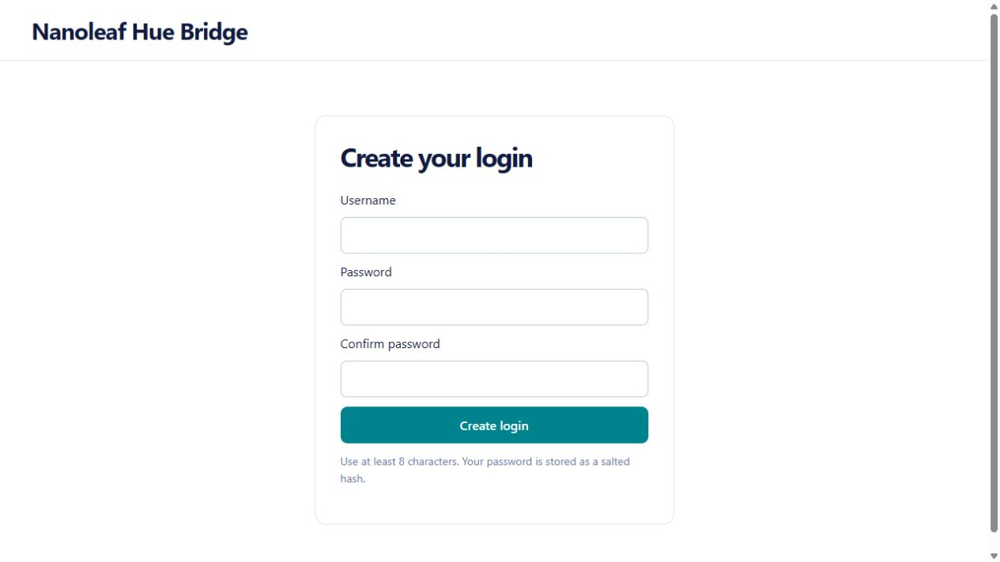
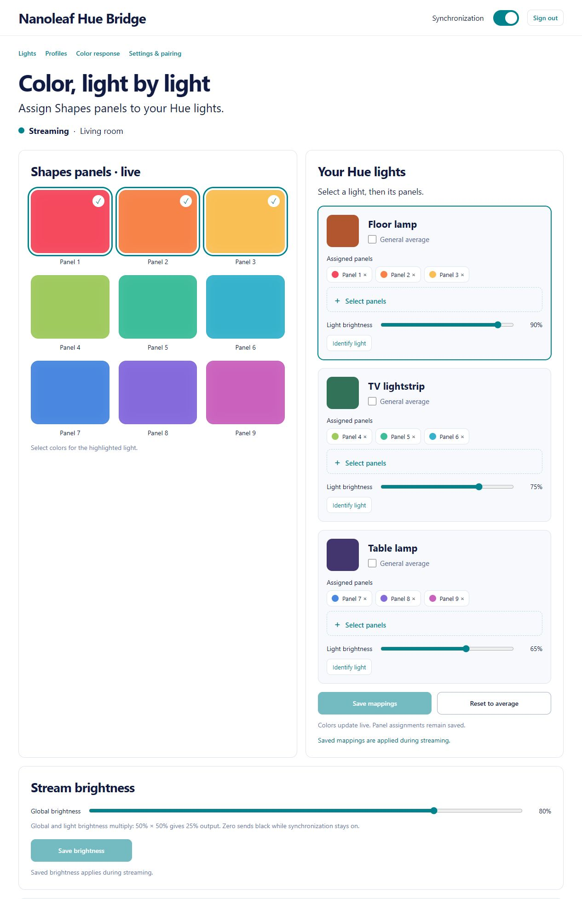
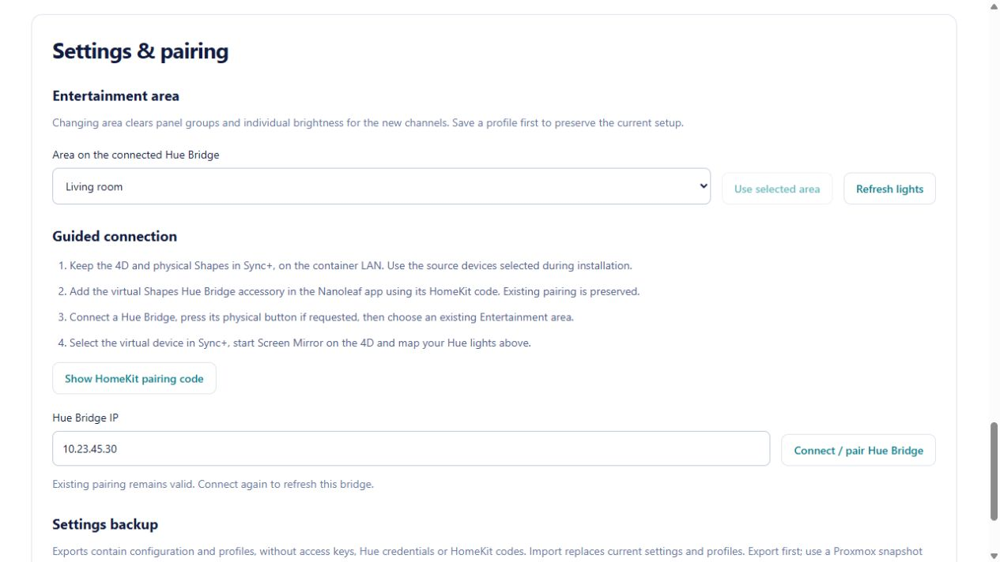
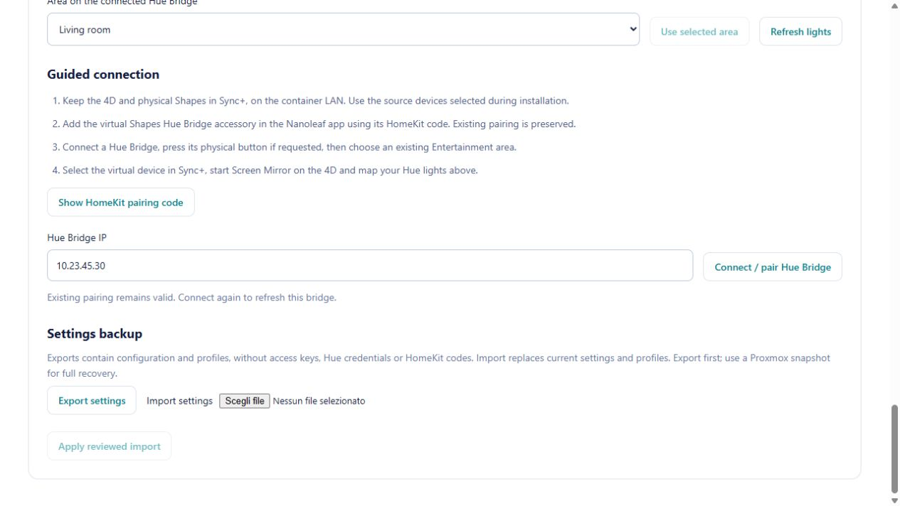
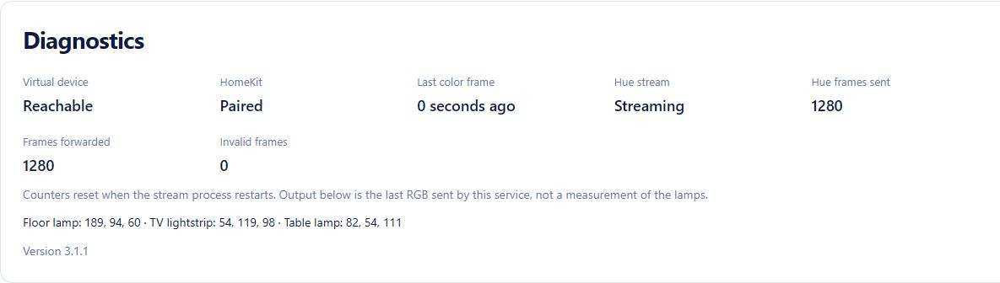

# Nanoleaf Hue Bridge

An experimental bridge that uses the **Nanoleaf 4D camera as a color source for
Philips Hue**, without a second video capture device. It provides guided setup
on a Debian 12 LXC container, an English web portal, and an on/off switch through
a virtual HomeKit light in the Nanoleaf app.

**Release 3.1.1** adds live panel mapping, brightness, profiles, color response,
Hue area management, reviewed settings backups, and first-visit username/password setup.

**Physical Nanoleaf Shapes already synchronized with the 4D are required.** The
bridge copies UDP packets addressed to those Shapes and forwards the original
packets to them. It does not read a camera API or implement a fully virtual
Sync+ receiver. The current version cannot work without physical Shapes.

## License

This project is **source-available for noncommercial use** under
[PolyForm Noncommercial 1.0.0](LICENSE). Personal home use and hobby projects are
permitted under its terms; commercial use is not granted. Third-party libraries
retain their own licenses. See [NOTICE.md](NOTICE.md) and
[LICENSE_AUDIT.md](LICENSE_AUDIT.md) for details.

## How it works

```text
4D camera -> Sync+ UDP frames -> LXC relay -> physical Shapes
                                  |-> Hue Entertainment -> Hue lights
Virtual HomeKit switch -------------> start/stop the bridge
```

The color stream uses extControl v2 on UDP port 60222, with RGB records for each
panel. The relay temporarily redirects traffic using ARP and immediately
forwards the original packets. Hue receives a DTLS 1.2 PSK / HueStream v2 stream,
rather than a REST request for each frame.

Turning on the virtual light makes the bridge wait for actual color frames
before starting Hue streaming. Turning it off restores the original network
path and releases the Hue area. The Hue lights keep their last color and become
available for normal control. Streaming stops after approximately two seconds
without frames and resumes when new frames arrive.

By default, each Hue light receives the **average Shapes color**. In the portal,
assign one panel or a group of panels to each light. The grid shows live colors
and panel IDs, rather than the physical arrangement of the Shapes.

## Requirements

- A fresh **Debian 12 LXC container**, with systemd, Internet access, and a root
  console. Suggested resources: 1 CPU core, 512 MB RAM, and 4 GB disk space.
  Docker is not required.
- A container interface on the **same LAN/VLAN as the 4D and Shapes**, with direct
  Layer 2 connectivity and no client isolation. Routing rules between VLANs
  alone are insufficient. The installer does not configure VLANs, Proxmox,
  routers, or access points.
- Stable IP addresses for the container, 4D, Shapes, and Hue Bridge. DHCP
  reservations are recommended.
- The 4D running Screen Mirror, with the physical Shapes powered on and selected
  in its Sync+ settings.
- A Hue Bridge v2 and lights compatible with Hue Entertainment. Create an
  Entertainment area in the Hue app if needed; the installer lets you select it.
- An iPhone for HomeKit pairing. Android/Matter onboarding is not implemented
  in this setup flow.
- An LXC container that permits `CAP_NET_RAW` and `AF_PACKET` sockets. The wizard
  checks this requirement. The original deployment used an unprivileged LXC
  container; the installer does not convert it to a privileged container.

## Information to prepare before installation

Have these details available before starting the wizard:

| Device or setting | Information to prepare | Automatic detection |
| --- | --- | --- |
| LXC container | Its LAN IP address and the network interface connected to the Nanoleaf LAN | The wizard lists local interfaces and IP addresses |
| Nanoleaf 4D | Its IPv4 address and, if available, its Wi-Fi MAC address | mDNS discovery offers the IP address; the wizard tries to detect the MAC from the local network |
| Physical Nanoleaf Shapes | Their IPv4 address and, if available, their Wi-Fi MAC address | mDNS discovery offers the IP address; the wizard tries to detect the MAC from the local network |
| Hue Bridge | Its IPv4 address | Enter it in the wizard; its MAC address is not required |
| Hue Entertainment area | The name of the area containing the lights you want to synchronize | The wizard lists areas after Hue pairing |
| Virtual light | A name you can recognize in the Nanoleaf app | The wizard generates its identity; no MAC address or HomeKit code needs to be supplied |

Find device IP addresses and MAC addresses in your router's DHCP lease list or
connected-device list. Use the MAC of the physical network interface, usually
shown as `AA:BB:CC:DD:EE:FF`; the Nanoleaf API's advertised `id` may differ from
the Wi-Fi MAC. DHCP reservations help keep the selected IP addresses stable.

Discovery is a convenience: keep the 4D and Shapes IP addresses available in case
mDNS discovery fails. Their physical MAC addresses are required by the relay,
but you only need to enter them manually if automatic detection fails. The
container must already have a working network connection before installation.

Also have your iPhone ready for the new HomeKit pairing code and physical access
to the Hue Bridge button. If you have not created an Entertainment area yet,
create one in the Hue app or do so when the wizard asks.

## Installation: one command, then guided setup

Once you have extracted the repository into the new container, run this command
from the repository directory:

```sh
bash install.sh
```

The installer updates and upgrades Debian packages, installs dependencies in an
isolated Python environment, creates a dedicated account for the virtual device,
and starts the setup wizard. You do not need to edit JSON files, create systemd
units, or run configuration commands at each step.

The wizard guides you through these steps in English:

1. Lists the container's interfaces and IP addresses so you can select the LAN
   interface.
2. Discovers Nanoleaf devices through mDNS. Select the 4D and Shapes, or enter
   their IP addresses manually.
3. Detects and proposes their physical MAC addresses. If detection fails, it
   asks you to enter them.
4. Asks for the Hue Bridge IP address and a name for the virtual light. It
   generates a unique virtual identity without cloning a physical Nanoleaf.
5. Starts the virtual device and displays its **HomeKit pairing code**. On your
   iPhone, open Home -> Add Accessory -> More Options, then check that the device
   appears in Nanoleaf. The console waits for and verifies successful pairing.
6. Asks you to press the Hue Bridge button and stores the resulting credentials
   privately.
7. Lists the **available Entertainment areas**, including their channel counts,
   and lets you select one. If none exist, it waits for you to create one in the
   Hue app.
8. Starts the web portal at `http://<container-ip>:8080`. On the first visit, choose
   a username and password of at least **8 characters**, then confirm the password.
   There is no initial access key or default account.
9. Enables the services at boot. The virtual light starts **off**. Turn it on in
   the app to test synchronization while moving images play on your television.

Phone interaction and pressing the Hue Bridge button are required; a container
command cannot replace those actions. Also enable **CT -> Options -> Start at boot**
in Proxmox. The installer inside the container does not administer the host.

### Direct download and installation

This is **one initial command**, including on a minimal Debian installation
without curl. Configuration then proceeds through prompts and menus.

```sh
apt-get update && apt-get install -y ca-certificates curl && curl -fsSL https://raw.githubusercontent.com/Cristef/nanoleaf-hue-bridge/main/bootstrap.sh -o /tmp/nanoleaf-hue-bootstrap.sh && bash /tmp/nanoleaf-hue-bootstrap.sh Cristef/nanoleaf-hue-bridge
```

`bootstrap.sh` downloads the current version of the `main` branch and starts the
installer.

## Daily use

Turn **Shapes Hue Bridge** (or your chosen name) on or off in the Nanoleaf app.
The container and supervisor stay running. You do not need to add the device
again or select it as a Sync+ receiver: the physical Shapes remain the receiver.

For maintenance, open the menu with:

```sh
nanoleaf-hue
```

The menu provides status, diagnostics, the HomeKit code, Hue area selection,
resuming an interrupted setup, service restarts, and service deactivation.
Pairings are preserved. After changing an area's lights in the Hue app, use
**Refresh lights** in the portal. If a running stream still uses the previous
channel list, turn the virtual device off and on to reconnect.

Deactivation stops and disables the services, restores ARP, and preserves files
and credentials for recovery or reinstallation. It does not delete all
credentials. To revoke Hue access, also remove the application from the Bridge.

## Web portal

Open `http://<container-ip>:8080` on the home LAN and create your login before
sharing access to the container. Passwords use salted PBKDF2 hashes; sessions
last 12 hours and end when the portal service restarts. Use **Sign out** to log
out. This is an HTTP portal for a trusted LAN: login does not encrypt traffic.
Do not expose it directly to the Internet. Password recovery currently requires
container administrator access; password changes are not available in this release.

### Illustrated quick start

These screenshots show the actual portal with **demonstration data**: example
lights, panel IDs, colors, counters and a fictitious Hue Bridge address. Your
lights and values will differ. No real credentials or HomeKit codes are shown.
Native file-picker labels follow your browser/operating-system language.

#### 1. Create your login

Open `http://<container-ip>:8080`, choose a username, enter a password of at least
**8 characters**, repeat it in **Confirm password**, then click **Create login**.
There is no installation access key or default password. Later visits display
**Username** and **Password** instead.



#### 2. Assign colors and set brightness

Start Screen Mirror on the 4D, keep the physical Shapes selected in Sync+, and
turn on the virtual accessory. The portal's **Synchronization** switch controls
the same on/off state as the Nanoleaf app. Wait for **Streaming** and incoming
panel colors.

1. In **Your Hue lights**, click **Select panels** for the light to configure.
2. Click one or more colored tiles. Check marks and panel chips show the selected
   group. The light receives the group's average color; a single panel supplies
   its own color. The grid identifies panels, not their physical positions.
3. Repeat for other lights and click **Save mappings**. Use **General average**
   to use all received panels for one light, or **Reset to average** to clear all
   groups in the draft, then save.
4. Set each **Light brightness** and **Global brightness**, then click **Save
   brightness**. These factors multiply: 80% global and 75% individual gives 60%
   RGB intensity. Zero sends black while synchronization stays enabled.
5. While streaming, **Identify light** briefly sends white to that light at its
   saved brightness so you can locate it.

Changes are previews until saved. **Discard unsaved changes** restores the saved
values. In the example, Floor lamp uses panels 1–3, TV lightstrip uses 4–6, and
Table lamp uses 7–9.



#### 3. Save and recall profiles

Open **Profiles**, enter a name such as Cinema or Gaming in **Profile name**, and
click **Save current setup**. A profile contains the Bridge, Entertainment area,
panel groups, brightness and color response. To overwrite a saved profile, use
its name and explicitly check **Replace existing profile**.

Choose an entry in **Saved profile** and click **Apply profile** to restore it.
**Delete profile** asks for confirmation and does not change the active stream
settings. Save or discard pending drafts before using these actions.


#### 4. Adjust color response

Open **Color response** and adjust the sliders, then click **Save color response**.
These settings apply to the whole stream.

| Control | Effect | Neutral/default value |
| --- | --- | --- |
| Transition smoothing | Softens transitions over time; adjustable from 0 to 2000 ms | 0 ms |
| Saturation | 0% gives grayscale; above 100% increases saturation, up to 200% | 100% |
| Black threshold | Sends black immediately when the highest input RGB component is below the threshold (0–255) | 0, disabled |

The screenshot shows example settings, not required or recommended defaults.
Swatches preview target colors; **Diagnostics** shows the actual smoothed output.


#### 5. Select an area or connect a Bridge

Open **Settings & pairing**. After changing your Entertainment area's lights in
the Hue app, click **Refresh lights**. Select another existing area and click
**Use selected area** when needed. Changing area clears its panel groups and
individual brightness; save a profile first to preserve the previous setup.

For another Hue Bridge on the container LAN, enter its IP and click **Connect /
pair Hue Bridge**. Follow the status message and press the physical Bridge
button if requested. When connected, choose an area and apply it. Create areas
in the Hue app; this portal selects them but does not create them.

**Show HomeKit pairing code** displays the virtual accessory's code for adding
it in the Nanoleaf app. Existing pairing is preserved. Source IP/MAC settings
remain in the terminal wizard.



#### 6. Back up or import settings

Click **Export settings** to download active settings and profiles before making
large changes. To restore them, choose a JSON file with **Import settings**, read
the validation summary, then click **Apply reviewed import**. Import replaces
current settings and profiles; save or discard drafts first.

Exports exclude portal passwords, Hue credentials and HomeKit pairing keys.
They are configuration backups, not complete container backups. Keep a Proxmox
snapshot for full recovery.



#### 7. Check synchronization

Read **Diagnostics** if the lights are not following the screen. Check virtual
device reachability, HomeKit pairing, incoming-frame age and Hue stream state.
Frame counters reset when the stream process restarts. The RGB values show what
this service sent, not a measurement of the physical lamps.



## Upgrade an existing public installation

Download/extract the new release inside the existing container, then run:

```sh
bash update.sh
```

The updater supports deployments created by this repository under
`/opt/nanoleaf-hue`. It backs up code, service definitions and private settings
under `/root/nanoleaf-hue-backups/`, briefly stops the services, installs the
portal and restarts them. Existing HomeKit identities, Hue credentials, portal
accounts and settings are preserved. Older deployments receive a **Current
setup** profile with average colors and 100% brightness. No initial access key
is generated. Keep the backup private; it includes credentials.

Take a Proxmox snapshot before upgrading. If startup fails, the updater restores
previous code/service definitions and restarts the original services. Custom
prototype installations with different paths are not automatically migrated.
The updater uses the existing Python environment; this release adds no Python
dependencies. For a fresh container use `install.sh`, not `update.sh`.

## Reliability and limitations

- The supervisor retries after errors and stops streaming if it cannot read the
  virtual device's state.
- systemd restarts the supervisor and restores ARP even after a forced process
  termination. MAC address resolution may require a retry at startup.
- **Power failure or network loss affecting the entire container or host:** the
  recovery code cannot run. Shapes synchronization may stop temporarily until
  ARP caches refresh or the container returns. This relay dependency is an
  architectural limitation that process restarts cannot eliminate.
- Hue allows only one active Entertainment stream. Avoid running another Hue
  Sync session simultaneously. The bridge does not automatically stop other
  areas.
- The RGB format and approximately 15 Hz stream were verified with a 4D NL69,
  Shapes NL42, firmware 12.4.1, and a Hue Bridge v2. Compatibility with other
  products, firmware versions, or networks has not been established.
- The portal and color controls were tested on an existing Debian 12 deployment.
  Automated tests cover setup provisioning, updates with simulated services,
  authentication, validation and stream processing. The complete new-release
  installation and physical pairing on a fresh container still require an
  independent hardware test.

## Data and services

| Path | Contents |
| --- | --- |
| `/etc/nanoleaf-hue/config.json` | IP and MAC addresses, name, virtual identity, and selected area |
| `/var/lib/nanoleaf-hue-virtual/` | On/off state, HomeKit code, and pairing keys |
| `/var/lib/nanoleaf-hue-sync/hue-auth.json` | Hue credentials; root access only |
| `/var/lib/nanoleaf-hue-sync/portal-settings.json` | Active settings and saved profiles |
| `/var/lib/nanoleaf-hue-sync/portal-access.json` | Username, salt and password hash; no plaintext password |
| `/etc/nanoleaf-hue/portal.env` | Portal environment generated by setup |
| `/run/nanoleaf-hue/` | Temporary operational state and latest frame |
| `/opt/nanoleaf-hue/` | Code, Python environment, and service templates |

The services are `nanoleaf-hue-virtual`, `nanoleaf-hue-sync` and
`nanoleaf-hue-panel`. The portal runs as root with an empty capability set and
restricted filesystem writes. The virtual device
runs under a dedicated account. The relay runs as root with capabilities limited
to `CAP_NET_RAW`. Never publish state directories, HomeKit codes, tokens, or packet
captures. Repository examples use documentation addresses from `192.0.2.0/24`.

## Development and tests

```sh
python3 -m venv .venv
.venv/bin/pip install -r requirements.txt
.venv/bin/python tests/run.py
bash -n install.sh bootstrap.sh update.sh
```

Tests use temporary configurations and synthetic LAN/documentation addresses without contacting
physical Nanoleaf or Hue devices. GitHub Actions runs tests on Python 3.11 and
3.12. See [NOTICE.md](NOTICE.md) for dependencies and sources, and
[LICENSE](LICENSE) for the PolyForm Noncommercial 1.0.0 license and
[LICENSE_AUDIT.md](LICENSE_AUDIT.md) for the dependency license review.
