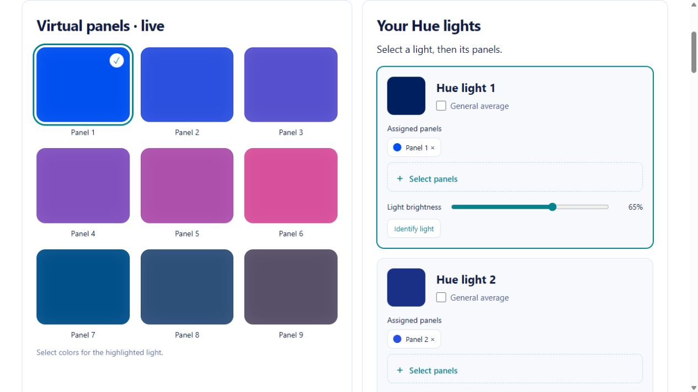
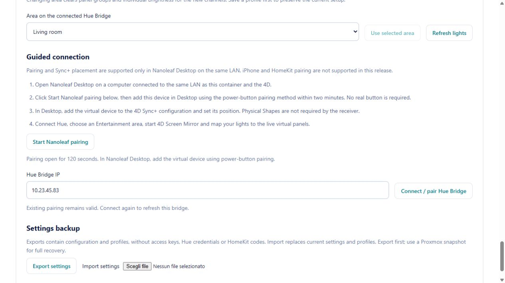

# Version 4 portal QA

The tested flow was sign-in -> Settings & pairing -> Start Nanoleaf pairing ->
two-minute pairing notice. The backend and UI used isolated synthetic state and
a mock pairing endpoint; no production device was modified.

Environment: Codex in-app browser, desktop viewport, local HTTP test server.
The standalone Browser plugin was unavailable; the available CUA browser APIs
provided the browser interaction and developer log checks.

| Check | Result |
| --- | --- |
| Page identity / meaningful content | Nanoleaf Hue Bridge, version 4.0.0 |
| Login flow | Test account signed in successfully |
| Virtual panels / lights | Nine panels and ten synthetic light rows rendered |
| Pairing interaction | Button returned 120-second Desktop pairing notice |
| Browser console | No error/warning entries in the validated flow |
| Visual evidence | Screenshots below; controls readable, no overlay |

Automated HTTP regression coverage additionally rejects anonymous and foreign-origin
pairing requests. API tests check expiration, internal authorization and persistent
external tokens. Full Linux suite: 63 tests.

Hardware limits: tested deployment has two Hue lights; ten channels are simulated.
Fresh Debian 12 installation with real Desktop-only pairing and mobile browser
layout remain to be tested. The pairing screenshot uses a mocked endpoint, not a
claim of a new physical pairing.

